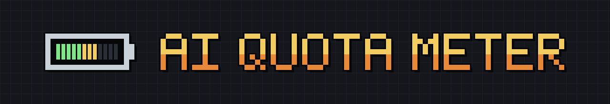

<p align="center">
  
</p>

<p align="center">
  <a href="https://github.com/sigiletlabs/ai-quota-meter/releases/latest"></a>
  <a href="https://github.com/sigiletlabs/ai-quota-meter/actions/workflows/ci.yml"></a>
  <a href="go.mod"></a>
  
  <a href="LICENSE"></a>
</p>

## Your Claude quota, on your status line

You can't see how much Claude quota you have left. Claude Code is told, on
nearly every turn, and doesn't show you unless you stop and ask. This puts it
on the status line, where you can glance at it:

```
Opus 5 (1M context)  ai-quota-meter  228k/1M  5h 62% (1h52m left)  7d 41% (4d left)
```

```sh
go install github.com/sigiletlabs/ai-quota-meter@latest
ai-quota-meter            # sets itself up and shows what your bar will look like
ai-quota-meter --doctor   # six checks, if anything looks wrong
```

Works with: `Claude Code` · `Codex` — Linux, macOS and Windows. Static binary, no network access.

**Those percentages are Anthropic's own.** Claude Code already receives them and
hands them to whatever you set as your status line. This program reports them
and calculates nothing. The numbers are as good as the vendor's, because they
*are* the vendor's.

---

## What's on the bar

| Item | Example | What it shows |
|------|---------|---------------|
| Model | `Opus 5 (1M context)` | The model this session is using |
| Directory | `ai-quota-meter` | Where Claude Code is running |
| Context | `228k/1M` | How full the context window is |
| Five-hour window | `5h 62% (1h52m left)` | How much of the five-hour quota you have used, and how long until it resets |
| Weekly window | `7d 41% (4d left)` | The same for the weekly quota |

## Install

Download the binary for your platform from
[releases](https://github.com/sigiletlabs/ai-quota-meter/releases), or:

```sh
go install github.com/sigiletlabs/ai-quota-meter@latest
```

Then run it:

```sh
ai-quota-meter
```

Run by hand with nothing set up yet, it installs itself: it points Claude Code
at the binary, keeps your other settings, backs the file up first, and prints
what your bar will look like. There is nothing else to configure.

Claude Code picks it up within about 30 seconds, with no restart.

If anything looks wrong:

```sh
ai-quota-meter --doctor
```

Six checks, each one saying how to fix what it found. Worth running before you
go hunting yourself, because Claude Code shows nothing at all — no error, no
stale line — for a status line command it cannot run.

Linux, macOS and Windows. No dependencies: standard library only, static
binary, no daemon, no network access. To build from a clone instead, run
`./build.sh`, or `./build.sh --all` for every platform at once.

Release binaries are built by CI from a tag and carry a
[build provenance attestation](https://docs.github.com/en/actions/how-tos/secure-your-work/use-artifact-attestations/use-artifact-attestations),
so you can check one came from this repository rather than from someone else:

```sh
gh attestation verify ai-quota-meter-linux-amd64 --repo sigiletlabs/ai-quota-meter
```

It prints nothing and exits 0 when the binary is genuine. A file that has been
altered exits 1.

They are not code-signed yet, so Windows will want an `Unblock-File` and macOS
a right-click Open the first time.

## What you'll see

The quota figures arrive only on plans that receive them, and not until the
first API response of a session. Until then the line is just the model and
directory:

```
Opus 5 (1M context)  ai-quota-meter
```

**That is expected, not a fault.** The figures were not sent, and this program
will not invent them.

On a narrow terminal the line wraps onto more rows rather than being cut off,
so a phone over mosh gets all of it stacked instead of the quota figures
disappearing off the right.

## Two things it does off the bar

Both are optional and both are safe to ignore.

**It writes each reading to a file**, so other tools can read your quota state
without an API call. Keyed by account, so figures from different Claude
accounts never pool. See [the capture files](docs/capture-files.md).

**It watches the vendor's own figures** and pushes a notification for the six
things worth acting on — a counter moving backwards, a window changing length,
a cap it does not recognise, and so on. At most one push an hour. Off until you
give it an ntfy topic. See [alerting](docs/alerting.md).

The one calculated number in this program lives there, not on the bar: an "at
this rate you run out Tuesday" projection beside a threshold. A bar is glanced
at continuously and absorbed as fact; a notification is read once, says "at
this rate", and shows the measured percentage next to it.

## If you also use Codex

`--install` sets up OpenAI Codex too, without being asked and without a flag.
If this machine has no Codex it says nothing at all.

You get the same items in the same order in both tools: model, directory,
context, then the two quota windows. Codex draws them in its own style, so the
bar looks like Codex rather than like the one above.

**This binary does not draw that bar, and never can.** Codex has no hook for
running a status line command — its setting is a list of widgets built into
Codex itself. What it does have is a five-hour and a weekly quota item already
built in, switched off by default. So `--install` switches them on and orders
them to match:

```toml
[tui]
status_line = ["model-with-reasoning", "current-dir", "context-used", "five-hour-limit", "weekly-limit"]
```

Codex renders that itself; this program is not in the loop. Restart Codex to
pick it up.

It also adds a `Stop` hook to `~/.codex/hooks.json`, so Codex readings reach the
capture files and the ntfy alerts the same way Claude Code readings do. Codex
runs the hook after each turn. It asks you to trust a new hook the next time it
starts: choose "Trust All and Continue". Until you do, the bar works and the
readings are not recorded.

It edits one line of your `config.toml`, and appends one hook to `hooks.json`,
and backs each file up first. A status
line you set yourself is replaced only after saying what it replaced, and
`--uninstall` puts back anything it did not write. Where it cannot be certain
it would edit the right thing, it refuses and tells you the line to add by
hand — a duplicate key would stop Codex starting, which is a far worse outcome
than a chore.

More in [Codex](docs/codex.md), including where the config lives on each
platform and why it edits text instead of parsing TOML.

## More

| Page | What's in it |
|------|--------------|
| [Codex](docs/codex.md) | What `--install` does on a machine with Codex, where its config lives on each platform, and why it edits text rather than parsing TOML |
| [Reference](docs/reference.md) | Every command, environment variable and rendering rule |
| [Design notes](docs/design.md) | The five constraints any change has to respect, and where this came from |
| [Capture files](docs/capture-files.md) | The per-account reading files other tools can read |
| [Alerting](docs/alerting.md) | The six notifications and how to turn them on |

## Licence

MIT.
